# Let's learn Godot — *Erbalta*

Un piccolo RPG in pixel art fatto per **imparare Godot 4 un passo alla volta**: un villaggio da esplorare, dialoghi, una missione, combattimenti a turni con scudi e debolezze, la morte che ti riporta indietro… e qualcuno, nel buio, che non vuole lasciarti andare.

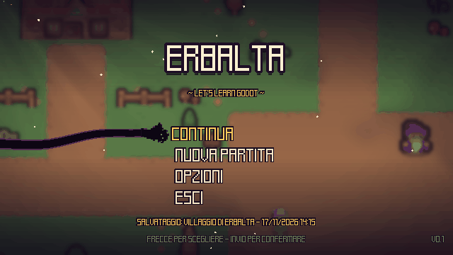

**Godot 4.7.2** · GDScript · pixel art · **111 test** automatici con gdUnit4 · un diario di sviluppo in [Obsidian](gamelog/Gamelog.md)

---

## Cosa c'è

<table>
<tr>
<td width="50%">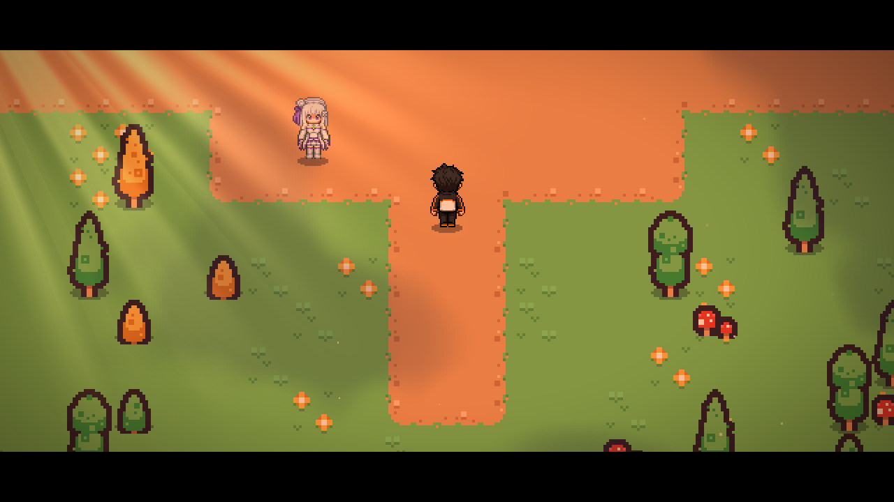</td>
<td width="50%">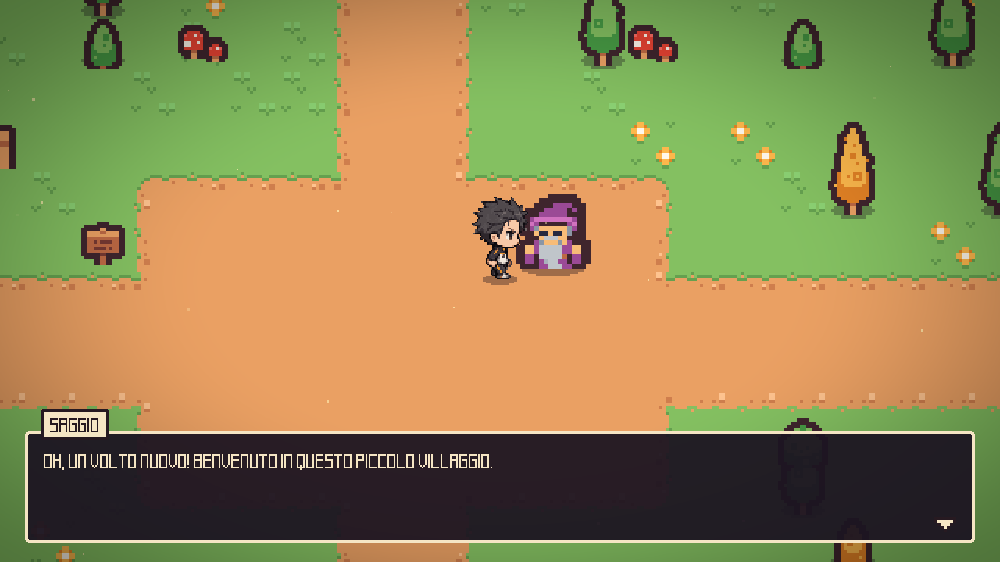</td>
</tr>
<tr>
<td><b>Il villaggio di Erbalta.</b> Raggi di sole, ombre delle nuvole, pollini, polvere quando corri, passi che si sentono.</td>
<td><b>Dialoghi.</b> Il Saggio, Emilia, Lina e un cartello. Si ricordano di te, anche tra una scena e l'altra.</td>
</tr>
<tr>
<td>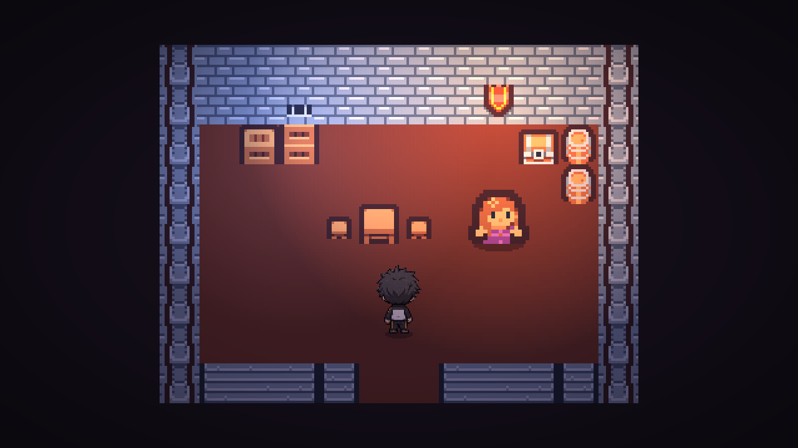</td>
<td>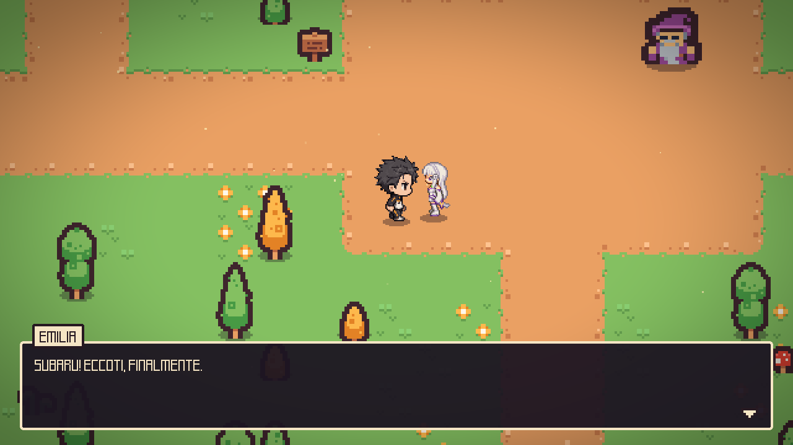</td>
</tr>
<tr>
<td><b>Una missione.</b> Lina ha perso la chiave del suo baule: trovala e portagliela. In alto a sinistra c'è sempre l'obiettivo.</td>
<td><b>Una cutscene</b> all'inizio, e personaggi che notano cosa ti è successo.</td>
</tr>
</table>

### La biblioteca

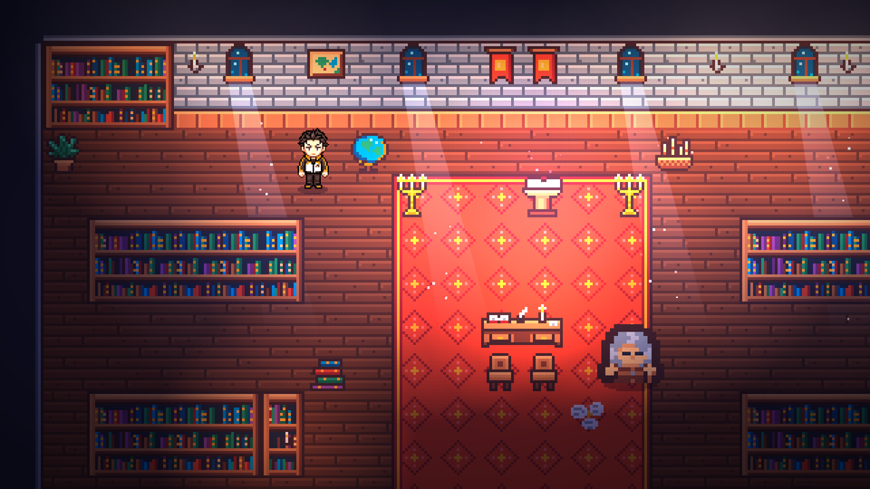

Una casa di pietra a nord-est del villaggio, con un **tileset disegnato apposta** in pixel art. Dentro è sempre notte: raggi di luna con la polvere che galleggia, candele che tremolano, un'Archivista, scaffali da leggere e un libro nero che forse non dovresti aprire.

### Colonna sonora

Tutta originale, sintetizzata nota per nota: un valzer per il villaggio (che si spegne quando ti avvicini al bordo), un carillon in re minore per la biblioteca, un tema di battaglia, e per il game over il tema del villaggio rotto e stonato. Con una risata.

### Combattimenti a turni

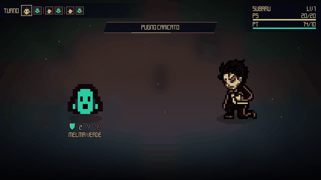

Attacca, **Abilità** (Calcio, Shamac, Pugno caricato, con i punti tecnica), Oggetti, Difendi, Fuggi. Ogni nemico ha uno **scudo** e delle **debolezze** da scoprire: colpiscile finché lo scudo si **rompe** e il nemico salta un turno. Vincendo si sale di livello.

I colpi si sentono: stelle d'impatto e fendenti disegnati a mano, lampi bianchi, scie, scintille, *hit stop* e onde d'urto che deformano lo schermo.

<table>
<tr>
<td width="50%">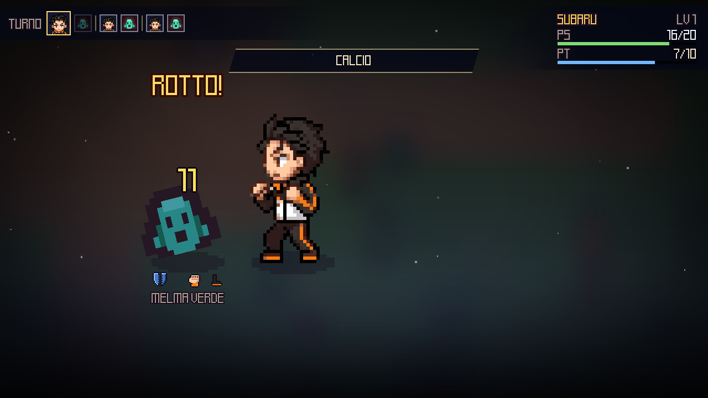</td>
<td width="50%">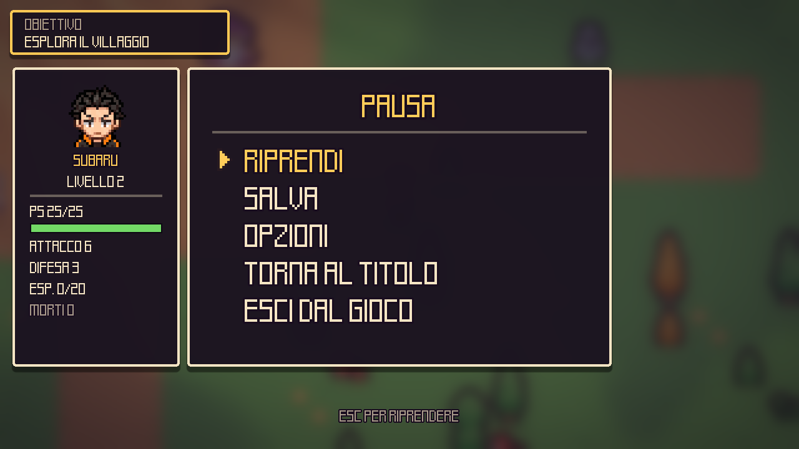</td>
</tr>
<tr>
<td><b>Rotto!</b> Scudo a zero: il nemico barcolla e prende il doppio dei danni.</td>
<td><b>Menu di pausa</b> con la scheda del personaggio, il salvataggio e le opzioni.</td>
</tr>
</table>

### Il Ritorno dalla Morte

Non provare a uscire dal villaggio. Se muori, una nebbia viola copre tutto… e puoi sempre *ritornare*. Il mondo dimentica; Subaru no.

<table>
<tr>
<td width="50%">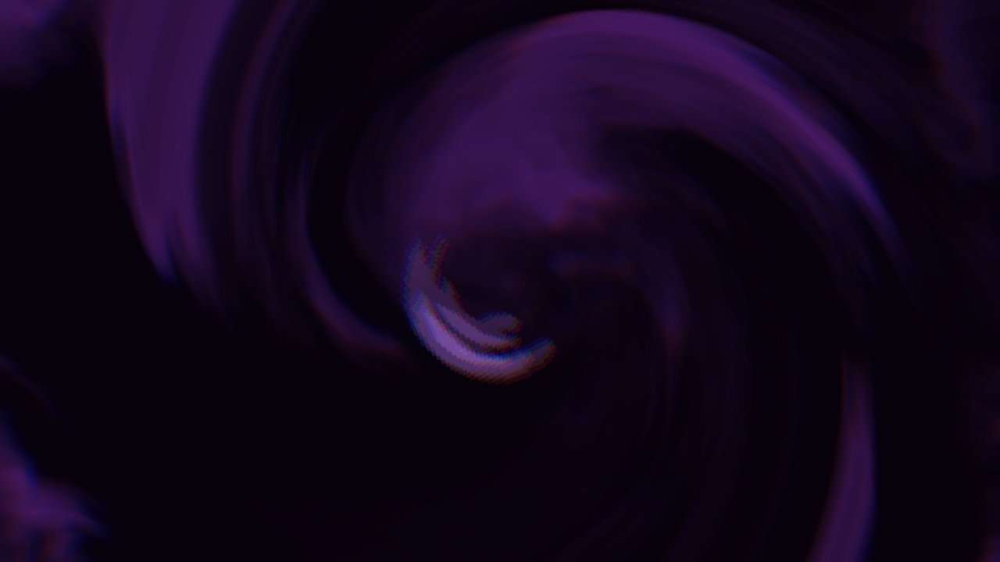</td>
<td width="50%">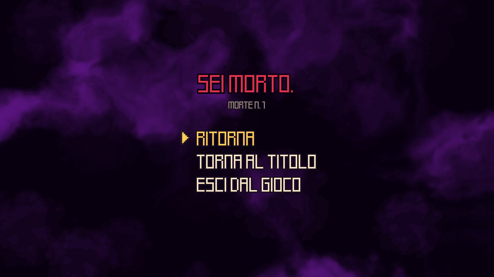</td>
</tr>
</table>

### Prova a chiudere il gioco

Quando esci, la finestra del gioco sparisce e sul desktop compare una finestra di sistema. Sembra normale. Poi si corrompe, ti chiama **per nome**, e se rispondi "Sì"… arriva lei. Le mani strappano la finestra, e nello strappo un occhio segue il tuo mouse.

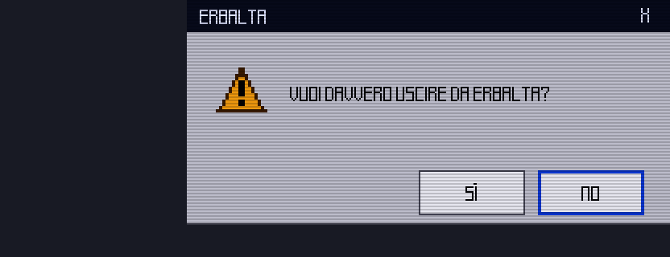

> Il nome è quello del tuo utente sul computer: si legge solo lì e non va da nessuna parte. Con "No" (o Esc) si torna a giocare.

---

## Come avviarlo

1. Apri **Godot 4.7** e importa la cartella `let's-learn-godot` (il file `project.godot`).
2. Premi **F5**.

| Tasto | Azione |
|---|---|
| Frecce o WASD | Muoversi |
| Shift (tenuto premuto) | Correre |
| E, Spazio o Invio | Parlare, interagire, andare avanti nel dialogo |
| Esc | Menu di pausa (riprendi, salva, opzioni, torna al titolo, esci) |
| Tab o I | Zaino (Invio usa l'oggetto selezionato) |

Nelle opzioni si regolano volume e schermo intero, e vengono ricordati. Dopo aver salvato, nel titolo compare *Continua*.

## Test

I test sono in `let's-learn-godot/test/` e usano [gdUnit4](https://github.com/godot-gdunit-labs/gdUnit4): **111** in tutto, dalle regole del combattimento al congedo.

- **Nell'editor:** pannello *GdUnit* → ▶.
- **Da terminale**, nella cartella `let's-learn-godot`:

```
test.cmd --godot_binary C:\percorso\Godot_v4.7.2-stable_win64.exe
```

(oppure imposta la variabile d'ambiente `GODOT_BIN` e lancia solo `test.cmd`). I report vanno in `reports/`.

## Com'è fatto

| Cartella | Contenuto |
|---|---|
| `let's-learn-godot/core/` | Gli autoload di base: stato della partita (`Game`), zaino (`Inventory`), salvataggio (`SaveSystem`), opzioni (`Settings`), suoni (`Sfx`), statistiche (`Stats`); le costanti `Facing` e `FlagKeys` |
| `let's-learn-godot/characters/` | Subaru (spritesheet, animazioni, azioni), i personaggi con cui parlare, i nemici sulla mappa |
| `let's-learn-godot/world/` | Il villaggio (`main.tscn`), la casa di Lina (`house.tscn`), la biblioteca (`library.tscn`) e i loro TileSet |
| `let's-learn-godot/ui/` | Titolo e mani d'ombra, menu di pausa, opzioni, dialoghi, zaino, il **combattimento** (`battle.gd` decide; `battle_vfx`, `battle_commands`, `battle_turn_bar`, `battle_enemy_info` disegnano), il Ritorno dalla Morte, il **congedo** (`farewell.gd`) |
| `let's-learn-godot/effects/` | Gli shader: vignettatura, sfocatura, raggi di sole, nuvole, nebbia, riavvolgimento, transizione di battaglia, lampo bianco, onda d'urto, ombra viva, glitch con lo strappo, ritaglio dell'occhio |
| `let's-learn-godot/interactables/`, `items/`, `enemies/`, `quests/`, `cutscenes/` | Oggetti e porte, gli oggetti dello zaino, i dati dei nemici, le missioni, l'intro |
| `let's-learn-godot/test/` | I test: `core/` e `quests/` (unitari), `world/`, `characters/` e `ui/` (di scena) |
| `let's-learn-godot/addons/` | gdUnit4 per i test; Dialogue Manager, Phantom Camera e Beehave, installati per i prossimi passi |
| `gamelog/` | Il diario di sviluppo, un vault di Obsidian |
| `docs/` | Le GIF di questo README |
| `sorgenti/` | I file di partenza, prima della pulizia |

## Il diario di sviluppo

Ogni passo è raccontato in [`gamelog/`](gamelog/Gamelog.md): cosa è stato fatto, **perché**, cosa non ha funzionato e cosa ho imparato di Godot. Ci sono una nota per ogni concetto (nodi, segnali, shader, tween, finestre…) e una voce di diario per ogni sessione. Per leggerlo al meglio apri la cartella `gamelog` come vault in [Obsidian](https://obsidian.md).

Qualche voce da cui partire:

- [I concetti di Godot](gamelog/godot-basi.md), spiegati con esempi presi dal progetto
- [Il combattimento](gamelog/progetto/Combattimento.md): turni, scudi, rottura e come è diviso il codice
- [Gli effetti visivi](gamelog/progetto/Effetti%20visivi.md) e [gli shader](gamelog/concetti/Shader.md)
- [Il congedo](gamelog/progetto/Congedo.md): finestre vere sul desktop, glitch, l'occhio che segue il mouse

## Crediti

Tileset, font, suoni e particelle di [Kenney](https://www.kenney.nl) (CC0), più qualche suono di altri autori: tutto è elencato in [CREDITS.md](CREDITS.md). Subaru ed Emilia sono personaggi di *Re:Zero* (© Tappei Nagatsuki, Kadokawa): sono usati solo per imparare, in un progetto personale e non commerciale. Gli effetti, le icone, le mani, gli occhi e le figure d'ombra sono disegnati da noi.
